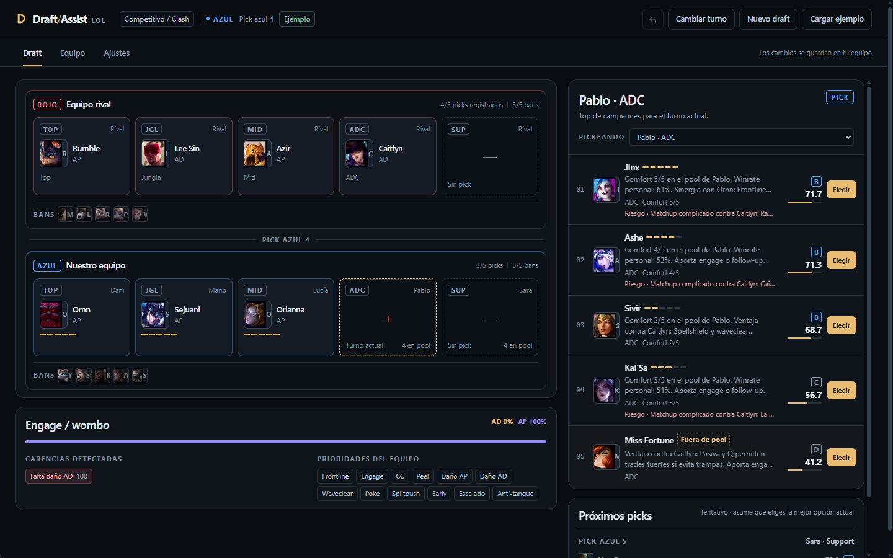

# Draft Assist

Asistente de draft para League of Legends, hecho con **Rust + Tauri v2** y frontend vanilla. Registra el estado real del champion select y devuelve un Top 5 explicado para el pick o ban actual.

[Repositorio](https://github.com/viejo27/draft-assist) · [Descargas](https://github.com/viejo27/draft-assist/releases)



- Datos locales de **Data Dragon 16.21.1** (173 campeones e iconos).
- Pool por jugador con comfort 1–5 y winrate opcional.
- Counters y sinergias en JSON editable.
- Plantillas **ranked solo** y **competitivo**.
- Recomendaciones con score, tier, razones y riesgos.
- Bans recomendados por amenaza y protección de bans propios.
- Próximos picks tentativos.
- **Seguimiento LCU de solo lectura**: sincroniza lobby, formato, lado, posiciones, bans y picks desde el cliente.
- **Rival de Clash**: chip en el header al abrir la app, bracket, próximo partido, roster propio y rival, rangos, maestrías y últimas partidas desde el LCU.
- **Historial local y scouting**: importa tu TXT de Clash, guarda picks, bans y resultados, y consulta estadísticas por campeón, bans, lado y rival.
- **Pools rivales**: agrega por nombre los campeones que fuiste anotando y corrige nombres con alias.
- **Historial como desempate opcional**: ±2 puntos, muestra mínima de 3 partidas y apagado por defecto.
- Persistencia local con autosave, export/import.

La app no automatiza picks ni bans; todas las acciones las confirma el usuario. El seguimiento LCU y la vista Rival solo leen el cliente; nunca envían acciones.

## Requisitos

- Rust estable con edition 2024 (probado con 1.96).
- Tauri v2 prerequisites para Windows: MSVC, WebView2.
- Node.js 20+ solo para ejecutar el CLI de Tauri y los scripts de datos.
- League of Legends abierto y logueado para usar el seguimiento LCU (opcional).

En PowerShell, si `npm` da error de execution policy, usa `npm.cmd` y `npx.cmd`.

## Instalación y arranque

```powershell
npm.cmd install
npm.cmd run dev
```

Equivalente sin instalar el CLI local:

```powershell
npx.cmd @tauri-apps/cli dev
```

Build de producción:

```powershell
npm.cmd run build
```

Genera el ejecutable en `target/release/draft-assist.exe` y los instaladores en `target/release/bundle/` (MSI y NSIS en Windows). Si solo quieres compilar sin empaquetar:

```powershell
npx.cmd @tauri-apps/cli build --no-bundle
```

## Icono

El icono fuente está en `src-tauri/app-icon.svg`. Para regenerar todos los tamaños:

```powershell
npx.cmd @tauri-apps/cli icon src-tauri/app-icon.svg
```

Los iconos resultantes se generan en `src-tauri/icons/`.

Tests del motor:

```powershell
cargo test -p draft-engine
```

Ejemplo CLI con el draft completo del README:

```powershell
cargo run -p draft-engine --example demo
```

La primera vez se abre con un **draft de ejemplo** cargado. Desde ahí puedes editar el tablero, cambiar el roster o empezar uno nuevo.

> `lol-things/` ya no es necesaria para ejecutar la app: el catálogo y los 173 iconos están copiados en `crates/draft-engine/data/` y `src/assets/champions/`. Puedes borrar esa carpeta. El script `scripts/prepare-data.mjs` funciona con `scripts/vendor/champion.json` si quieres regenerar el catálogo.

## Uso rápido

1. **Nuevo draft** → elige `Ranked solo` o `Competitivo`, y tu lado (azul/rojo).
2. **Equipo** → revisa los 5 jugadores, su orden de picks y su pool. Ajusta comfort y winrate.
3. **Draft** → registra bans y picks. Si el turno es del rival, la app te pide registrar su acción.
4. En tu turno, el panel derecho muestra el Top 5. Cada carta indica:
   - campeón, rol y score 0–100;
   - tier S/A/B/C/D;
   - comfort y advertencia si está fuera del pool;
   - justificación de 2–3 líneas y riesgos.
5. Pulsa **Elegir** o **Banear** para bloquear la acción y avanzar el turno.
6. Usa **Deshacer** (`Ctrl/Cmd+Z`) para corregir, o **Cambiar turno** para saltar a otro paso de la plantilla.
7. **Historial** → importa tu TXT de Clash o guarda la partida actual. Revisa estadísticas, bans y rivales.
8. **Rival** → si hay un torneo de Clash activo, revisa el bracket, el próximo rival, sus rangos, maestrías y últimas partidas.

## Seguimiento LCU

En la barra de vistas aparece el estado del cliente (`Sin cliente`, `Lobby`, `Champ Select`, etc.). El botón **Seguimiento** abre un diálogo de confirmación y activa la sincronización.

Qué hace:

- Detecta el cliente local de League of Legends por su lockfile o por los argumentos de `LeagueClientUx.exe`.
- Lee el lobby y el champ select cada segundo.
- Aplica la plantilla según la cola:

| Cola | Plantilla |
|---|---|
| Ranked Solo/Duo (420), Ranked Flex (440), Normal Draft (400) | Ranked |
| Clash (700) | Competitivo |
| Custom con bans simultáneos | Ranked |
| Custom con bans secuenciales | Competitivo |
| Cola desconocida | Se infiere por `hasSimultaneousBans`; si no existe, Ranked con aviso |

- Mapea `assignedPosition` del LCU a los roles del roster: `top`, `jungle`, `middle`, `bottom`, `utility`.
- Sincroniza lado, bans, picks, jugador que está pickeando y fase actual.
- Conserva nombres, pools, comfort y winrate del roster.
- Hace el tablero de solo lectura mientras está activo.

Qué **no** hace:

- No envía picks ni bans al cliente.
- No modifica **Prioridad estricta del pool**.
- No modifica **Permitir flex fuera de rol**.
- No inventa posiciones enemigas: usa el rol del campeón cuando el LCU no lo expone.

Requisitos y límites:

- League debe estar abierto en el mismo PC y con la misma sesión de usuario.
- El seguimiento se queda armado entre partidas hasta pulsar **Detener**.
- Si el cliente se reinicia, la app recalcula el puerto/token y reintenta.
- LCU es una API local no oficial; puede cambiar entre parches.
- Para detenerlo: botón **Detener** en la barra o en el banner del tablero.

El estado se guarda automáticamente en:

```text
%APPDATA%/viejo27.draft-assist/state.json
```

Los JSON editables se copian a `%APPDATA%/viejo27.draft-assist/data/`.

## Rival de Clash

La pestaña **Rival** lee el bracket de Clash desde el cliente local y arma la ficha del equipo contrario.

Qué muestra:

- torneo, estado y próximo cambio de fase;
- nuestro roster, récord y bracket;
- próximo partido: ronda, estado, horario y rival;
- por cada jugador rival: posición, nivel, rango Solo/Duo y Flex con LP y winrate;
- campeones más jugados de la temporada con PJ, winrate y KDA;
- maestrías principales;
- últimas 5 partidas con campeón, resultado, KDA y cola.

Cómo lo obtiene:

- `/lol-clash/v1/tournament-summary`
- `/lol-clash/v1/bracket/{bracketId}`
- `/lol-clash/v1/roster/{rosterId}`
- `/lol-summoner/v2/summoners`
- `/lol-clash/v1/scouting/champions`
- `/lol-ranked/v1/cached-ranked-stats/{puuid}` y `/lol-ranked/v1/ranked-stats/{puuid}`
- `/lol-match-history/v1/products/lol/{puuid}/matches`

Al abrir la app se hace **una sola consulta** para saber si hay Clash. Si hay torneo, el header muestra un chip con el día y horario de la próxima fase. No hay polling automático: la vista Rival se actualiza al abrirla o al pulsar **Actualizar**.

Si todavía no tenés equipo, la vista muestra una leyenda para **crear un equipo o unirte a uno desde League of Legends**. Si ya tenés equipo, muestra el roster propio con sus miembros, posiciones y estados (aceptado, no listo o invitación pendiente) antes de que empiece el Clash.

Todo es de solo lectura y no consulta la Riot API ni un proxy externo: los datos salen del cliente local.

Límites:

- Necesita Clash habilitado en la región. Antes de que se forme el bracket solo se muestra el torneo y nuestro equipo.
- El cliente puede no exponer el roster rival hasta que el bracket esté listo.
- Si el cliente no tiene historial cacheado de un jugador, esa sección aparece vacía.
- LCU no es una API oficial; los endpoints pueden cambiar entre parches.

## Historial y scouting

La pestaña **Historial** guarda partidas locales: picks, bans, resultado, lado, primer ban y los pools de los rivales que hayas scouteado. Todo queda en tu equipo.

### Importar tu archivo de Clash

1. Historial → **Importar Clash**.
2. Selecciona el `.txt` con bloques separados por `////`.
3. La app muestra un resumen: partidas, rebalanceos, nombres faltantes y tokens por revisar.
4. Importa todo o solo las partidas de confianza alta.
5. Corrige nombres desde **Rivales → Renombrar**.

También puedes generar los archivos limpios fuera de la app:

```powershell
cargo run -p draft-engine --example import_history -- ban-clash.txt private
```

Genera `private/clash-history.json`, `private/clash-history.clean.txt`, `private/clash-history.review.md` y `private/clash-import-report.json`. La carpeta `private/` está en `.gitignore`.

El parser:

- Acepta roles `top`, `jungle`, `mid`, `adc`, `support`, `fill`, `comodin`, `random`, `aram`, `autofill`, `nada`.
- Separa `main` y `last` por `/` o `|`.
- Reconoce alias y typos: `fiddlestick`, `evelyn`, `renata`, `yummi`, `bardo`, `leblanck`, `lysandra`, `chogat`, `lilia`, `zaheen`, `huawei`, `cantautora`, etc.
- Extrae rango con división: `Nombre Plata II` → nombre `Nombre`, rango `Plata II`.
- Infiere el lado por el primer pick y el primer ban por la primera sección de bans.
- Rebalancea picks/bans 6/4 a 5/5 moviendo la última entrada, con aviso.
- No inventa resultados, fechas ni nombres.

### Estadísticas

- Resumen: partidas, winrate, racha, mejor campeón, amenaza rival y ban más repetido.
- Nuestros picks: PJ, récord, winrate y veces que el rival lo baneó.
- Amenazas rivales: PJ, récord, winrate en contra y nuestros bans.
- Bans: propios y rivales, con winrate contextual y muestra.
- Filtros por cola, resultado, lado, primer ban, completas y búsqueda por rival/campeón.

### Scouting

- **Rivales** agrega por nombre todos los pools que fuiste anotando.
- Muestra roles vistos, main/last pool, récord contra él, notas y última partida.
- **Ver partidas** filtra el historial por ese rival.
- **Renombrar** corrige el nombre en todas sus partidas y guarda un alias para futuras importaciones.

### Historial como desempate

En Ajustes puedes activar **Usar historial como desempate**. Está apagado por defecto y nunca sustituye al scoring principal:

- **Picks:** winrate propio por campeón, centrado en 50%, con 3+ partidas.
- **Bans:** amenaza rival por winrate en contra y frecuencia de bans rivales.
- **Ajuste máximo:** ±2 puntos sobre 100.
- No cambia la prioridad estricta del pool ni el flex fuera de rol.
- Si un campeón está en tu pool, el historial no le da bonus positivo como ban.
- Cuando aporta, la carta muestra una línea `Historial · ...`.

El peso y la muestra mínima se pueden editar en `scoring.json`:

```json
"history_weight": 0.02,
"history_min_games": 3
```

### Privacidad y archivos

```text
%APPDATA%/viejo27.draft-assist/history/history.json
%APPDATA%/viejo27.draft-assist/history/history.backup-*.json
%APPDATA%/viejo27.draft-assist/exports/history-*.json
%APPDATA%/viejo27.draft-assist/exports/history-*.txt
```

- `private/` y `ban-clash.txt` están en `.gitignore`.
- El ejemplo público usa nombres falsos: [`examples/clash-history.example.json`](examples/clash-history.example.json).
- Cada guardado crea un backup y conserva los últimos 5.

### Límites

- El archivo viejo no registra nuestros nombres ni fechas; esas partidas dan estadística por campeón y rival, no por jugador.
- Las partidas nuevas guardadas desde el draft sí incluyen el jugador que pickeó.
- El historial es global por campeón; el archivo viejo no permite atribuir nuestros picks a jugadores concretos.
- El historial es solo un desempate opcional, no sustituye al scoring principal.
- `ff` se interpreta como derrota; `se rompió` como resultado desconocido.

## Modelo de entrada

El comando `recommend` recibe:

```json
{
  "draft": {
    "version": 1,
    "side": "BLUE",
    "template_id": "tournament",
    "step_index": 17,
    "our_bans": ["Yuumi", "Smolder", "KSante", "Aurora", "Skarner"],
    "enemy_bans": ["Malphite", "Lulu", "Rakan", "Poppy", "Vi"],
    "our_picks": [
      { "player_id": "top", "champion_id": "Ornn", "role": "TOP" },
      { "player_id": "jungle", "champion_id": "Sejuani", "role": "JUNGLE" },
      { "player_id": "mid", "champion_id": "Orianna", "role": "MID" }
    ],
    "enemy_picks": [
      { "champion_id": "Rumble", "role": "TOP" },
      { "champion_id": "LeeSin", "role": "JUNGLE" },
      { "champion_id": "Azir", "role": "MID" },
      { "champion_id": "Caitlyn", "role": "ADC" }
    ],
    "priorities": [],
    "current_player_id": "adc",
    "manual": null
  },
  "roster": {
    "players": [
      {
        "id": "adc",
        "name": "Pablo",
        "role": "ADC",
        "pool": [
          { "champion_id": "Jinx", "comfort": 5, "winrate": 61.0 },
          { "champion_id": "Ashe", "comfort": 4, "winrate": 53.0 },
          { "champion_id": "Kaisa", "comfort": 3, "winrate": 51.0 },
          { "champion_id": "Sivir", "comfort": 2, "winrate": null }
        ]
      }
    ],
    "pick_order": ["top", "jungle", "mid", "adc", "support"]
  },
  "options": {
    "top_n": 5,
    "allow_offrole_flex": false,
    "pool_precedence": true,
    "include_next_picks": true,
    "use_history": false
  },
  "history": null
}
```

`options.use_history` activa el desempate por historial. `history` es opcional y lleva señales compactas por campeón; no se envía el historial completo. Si se omite, no hay ajuste.

> El roster de ejemplo completo está en [`examples/example-state.json`](examples/example-state.json). Incluye los 5 jugadores.

### Roles

`TOP`, `JUNGLE`, `MID`, `ADC`, `SUPPORT`.

### Lados y fases

- `side`: `BLUE` o `RED`.
- `step_index` es 0-based dentro de la plantilla elegida.
- `priorities`: `frontline`, `engage`, `cc`, `peel`, `ap_damage`, `ad_damage`, `waveclear`, `poke`, `splitpush`, `early`, `scaling`, `anti_tank`.

### Plantillas

- **ranked**: bans simultáneos (5 por equipo) + picks `B1, R1, R2, B2, B3, R3, R4, B4, B5, R5`.
- **tournament**: bans por fases + picks `B1, R1, R2, B2, B3, R3`, segundo bloque de bans, `R4, B4, B5, R5`.

## Modelo de salida

```json
{
  "summary": {
    "side": "BLUE",
    "phase": "PICK",
    "turn_label": "Pick azul 4",
    "current_player": { "id": "adc", "name": "Pablo", "role": "ADC" },
    "composition": {
      "damage_split": { "physical": 0.0, "magic": 1.0, "mixed": 0.0 },
      "archetype_label": "Engage / wombo",
      "needs": [
        { "id": "ad_damage", "label": "Falta daño AD", "severity": 1.0 }
      ]
    }
  },
  "recommendations": [
    {
      "rank": 1,
      "champion": { "id": "Jinx", "name": "Jinx", "roles": ["ADC"] },
      "role": "ADC",
      "action": "PICK",
      "score": 71.7,
      "tier": "B",
      "in_pool": true,
      "comfort": 5,
      "off_pool_warning": null,
      "justification": "Comfort 5/5 en el pool de Pablo. Winrate personal: 61%. Sinergia con Ornn: Frontline sólida y engage a distancia para Jinx.",
      "reasons": ["..."],
      "risks": ["..."],
      "breakdown": {
        "matchup": 0.3,
        "synergy": 0.82,
        "needs": 1.0,
        "comfort": 1.0,
        "meta": 1.0,
        "flex": 0.24,
        "counter_risk": 0.4,
        "pool_penalty": 0.0
      }
    }
  ],
  "next_picks": [],
  "warnings": []
}
```

La salida completa del ejemplo está en [`examples/example-recommendation.json`](examples/example-recommendation.json). Si el desempate por historial está activo y aporta, cada recomendación incluye un objeto `history` con puntos, récord y nota; si no aporta, se omite.

## Ejemplo completo

Escenario: **azul**, plantilla competitiva, turno **B4** (nuestro ADC, Pablo).

- Bans propios: Yuumi, Smolder, K’Sante, Aurora, Skarner.
- Bans enemigos: Malphite, Lulu, Rakan, Poppy, Vi.
- Nuestros picks: Ornn (TOP), Sejuani (JUNGLE), Orianna (MID).
- Enemigos: Rumble (TOP), Lee Sin (JUNGLE), Azir (MID), Caitlyn (ADC).
- Pool ADC: Jinx 5, Ashe 4, Kai’Sa 3, Sivir 2.

Resultado real del motor con los datos incluidos:

| # | Campeón | Score | Tier | Pool | Lectura |
|---:|---|---:|---|---|---|
| 1 | **Jinx** | 71.7 | B | Comfort 5 | La mejor combinación de comfort y sinergia con Ornn/Sejuani/Orianna; Caitlyn castiga su early. |
| 2 | **Ashe** | 71.3 | B | Comfort 4 | Buen follow-up de engage y utilidad; menos DPS puro que Jinx. |
| 3 | **Sivir** | 68.7 | B | Comfort 2 | Spellshield y waveclear contra Caitlyn/Rumble/Azir; el comfort bajo la frena. |
| 4 | **Kai’Sa** | 56.7 | C | Comfort 3 | Dive con Sejuani/Ornn, pero sufre el rango de Caitlyn. |
| 5 | **Miss Fortune** | 41.2 | D | Fuera de pool | Buen matchup de lane, pero el motor la penaliza por no estar en el pool. |

Carencias detectadas: **falta daño AD sostenido** (Ornn, Sejuani y Orianna son AP). Frontline, engage y CC ya están cubiertos.
Próximo pick tentativo (support): **Nautilus** (pool, 72.8) como engage/peel; **Milio** aparece más abajo como opción de pool con comfort 2.

Los números pueden variar si editas `champion-meta.json`, `matchups.json`, `synergies.json` o `scoring.json`.

## Cómo decide

Componentes: comfort, matchup de línea, riesgo de counters, sinergia curada/estructural, carencias de composición, prioridad meta y flexibilidad.

- **Picks tempranos:** pesan más comfort, meta y flex/seguridad.
- **Picks tardíos:** pesan más matchup y counter directo.
- **Pool primero:** por defecto, todos los campeones del pool se ordenan antes que los off-pool. Los off-pool siguen visibles con advertencia.
- **Bans:** priorizan amenaza a tus picks/pools y penalizan los bans propios.
- **Historial (opcional):** con 3+ partidas, ajusta como máximo ±2 puntos. En picks usa tu winrate por campeón; en bans usa el winrate rival en contra y la frecuencia de bans. No cambia la prioridad del pool ni el flex.

El detalle técnico está en [`docs/DESIGN.md`](docs/DESIGN.md). El sistema visual está en [`DESIGN.md`](DESIGN.md).

## Datos editables

```text
crates/draft-engine/data/
├─ champions.json        # catálogo DDragon (generado)
├─ champion-meta.json    # roles, flex, daño, traits, prioridad
├─ matchups.json         # counters con valor -1..1 y severidad 1..3
├─ synergies.json        # pares con valor 0..1
├─ templates.json        # ranked / tournament
├─ scoring.json          # pesos, umbrales, tiers, history_weight, history_min_games
└─ example-state.json    # ejemplo ejecutable
```

La app copia estos archivos a `app_data_dir/data/` en el primer arranque. Edita ahí y pulsa **Ajustes → Recargar datos** sin recompilar.

Para regenerar el catálogo desde Data Dragon:

```powershell
node scripts/prepare-data.mjs
```

Usa `scripts/vendor/champion.json` (copia local) o `lol-things/16.21.1/...` si existe. `scripts/seed-meta.mjs` regenera la metadata heurística; **sobrescribe** `champion-meta.json`, así que úsalo solo si quieres volver al seed.

## Estructura del proyecto

```text
crates/draft-engine/      motor Rust puro + datos + tests + demo
crates/draft-engine/src/history/  parser, modelos y texto del historial
src-tauri/                comandos Tauri, persistencia y ventana
src-tauri/src/lcu/        cliente, credenciales, mapeo y tracker LCU
src/                      UI vanilla, estilos e iconos
src/js/history.js         estadísticas, filtros y perfiles de rivales
scripts/                  generación de datos y preview
examples/                 estado, recomendación e historial de ejemplo
docs/DESIGN.md            arquitectura, modelo y scoring
DESIGN.md                 sistema visual
PRODUCT.md                contexto de producto
private/                  historial personal (gitignored)
```

## Tests y calidad

```powershell
cargo test --workspace
node --test src/js/history.test.js
cargo fmt --check
cargo clippy --workspace --all-targets -- -D warnings
```

Tests cubiertos: dataset completo, exclusión de bans/picks, rol, carencias, prioridad de pool, off-pool, bans, matchups, serialización, flex fuera de rol y diferencia early/late. También hay tests de lockfile/credenciales LCU, mapeo de posiciones, detección de ranked/competitivo, mapeo de picks/bans y `lcu_turn`. El módulo de Clash agrega tests de selección de torneo/bracket, identificación del roster, próximo partido, resultados, rangos y parseo de match history. El historial añade tests de bloques completos, rebalanceo 6/4, alias de campeones, rangos, fill/comodín, notas, importación y estadísticas/filtros/scouting en JavaScript. El desempate por historial añade tests de muestra mínima, dirección del ajuste, protección de bans propios y prioridad de pool.

## Problemas comunes

- **`npm.ps1 cannot be loaded`**: usa `npm.cmd`/`npx.cmd`.
- **No abre la ventana**: verifica WebView2 y los prerequisites de Tauri.
- **Datos editables inválidos**: la app cae a los datos embebidos y muestra un aviso. Corrige el JSON en `app_data_dir/data/` y pulsa Recargar datos.
- **Quiero volver al ejemplo**: botón **Cargar ejemplo** en la barra superior.
- **El build falla con “file is being used”**: cierra la app abierta antes de ejecutar `npm.cmd run build`; Windows no puede parchear el `.exe` en uso.
- **“Reconectando con League”**: es normal si el cliente se está abriendo, cerrando o reiniciando. La app reintenta sola y no muestra URLs ni puertos. Si persiste, comprueba que League esté abierto y logueado.

## Mejoras futuras

- Captura automática de resultados con el Live Client Data API (`https://127.0.0.1:2999/liveclientdata/allgamedata`): al terminar la partida indica victoria/derrota y se integraría con los datos de la partida en vivo.
- LCU por WebSocket para latencia menor que el polling actual.
- Auto-hover/auto-lock opcional en el cliente (no implementado; solo con confirmación explícita, aviso de overrides de pool/flex y botón de emergencia).
- Riot API para maestría y estadísticas propias (futuro, no implementado; requiere production key y aprobación de Riot).
- Proxy propio sobre Riot API para enriquecer la vista Rival con datos que el LCU no expone.
- Draft fearless con bans acumulados por serie.
- Optimización conjunta de los 5 bans de ranked.
- Simulación de respuestas enemigas y Monte Carlo.
- Historial de drafts/scrims y vista de coach.
- Tests E2E de UI y accesibilidad.

## Licencia

El código de Draft Assist está bajo la licencia MIT. Ver [`LICENSE`](LICENSE).

Los datos e imágenes de campeones son propiedad de Riot Games y se usan bajo la política de Riot/Data Dragon. No están cubiertos por la licencia MIT y no pueden usarse comercialmente. Ver [`ATTRIBUTION.md`](ATTRIBUTION.md).

## Aviso legal

Draft Assist isn't endorsed by Riot Games and doesn't reflect the views or opinions of Riot Games or anyone officially involved in producing or managing Riot Games properties. Riot Games, and all associated properties are trademarks or registered trademarks of Riot Games, Inc.
